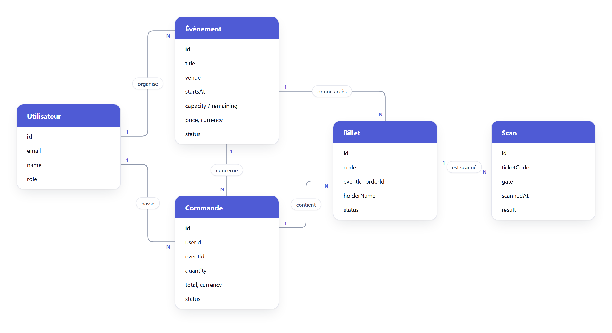

# Orbitale — modèle de ressources (livrable S1)

Binôme :
Date : 20 novembre 2026

## 1. Ressources métier

| Ressource | Description en une phrase | Attributs principaux | Qui la crée ? | Qui la lit ? |
|---|---|---|---|---|
| Événement | Un concert ou un spectacle mis en vente. | id, title, description, venue, startsAt, capacity, remaining (calculé), price, currency, status (draft, published, cancelled) | L'organisateur | Tout le monde (site, appli, bornes) |
| Billet | Le droit d'entrée d'une personne à un événement. | id, code, eventId, orderId, holderName, status (valid, used, cancelled) | L'API, quand une commande est payée | Le spectateur qui l'a acheté, l'organisateur |
| Commande | L'achat d'un ou plusieurs billets pour un événement. | id, userId, eventId, quantity, total, currency, status (pending, paid, cancelled), createdAt | Le spectateur | Le spectateur qui l'a passée, l'organisateur |
| Utilisateur | Une personne inscrite sur Orbitale. | id, email, name, role (spectator, organizer, admin), createdAt | La personne elle-même, à l'inscription | L'utilisateur lui-même, l'admin |
| Scan | Le passage d'un billet devant une borne à l'entrée. | id, ticketCode, gate, scannedAt, result (accepted, rejected) | La borne | L'organisateur |

## 2. Relations

- Un événement a plusieurs billets, un billet correspond à un seul événement.
- Une commande regroupe un ou plusieurs billets, un billet appartient à une seule commande.
- Une commande porte sur un seul événement.
- Un utilisateur peut passer plusieurs commandes.
- Un organisateur (utilisateur avec le rôle organizer) gère plusieurs événements.
- Un billet peut être scanné plusieurs fois : le premier scan est accepté, les suivants sont refusés.

## 3. Endpoints

| Méthode | URI | Rôle | Succès | Erreurs possibles |
|---|---|---|---|---|
| GET | /v1/events | Lister les événements | 200 | 422 (filtre invalide) |
| POST | /v1/events | Créer un événement | 201 + Location | 401, 403 (pas organisateur), 422 (données invalides) |
| GET | /v1/events/{eventId} | Lire un événement | 200 | 404 |
| PATCH | /v1/events/{eventId} | Modifier un événement | 200 | 403, 404, 422 |
| DELETE | /v1/events/{eventId} | Supprimer un événement | 204 | 403, 404, 409 (billets déjà vendus) |
| POST | /v1/orders | Passer une commande | 201 + Location | 401, 404 (événement inconnu), 409 (plus assez de places), 422 (quantité invalide) |
| GET | /v1/orders | Lister ses commandes | 200 | 401 |
| GET | /v1/orders/{orderId} | Lire une commande | 200 | 403, 404 |
| PATCH | /v1/orders/{orderId} | Annuler une commande | 200 | 403, 404, 409 (déjà annulée ou événement passé) |
| GET | /v1/orders/{orderId}/tickets | Lister les billets d'une commande | 200 | 403, 404 |
| GET | /v1/tickets/{ticketId} | Lire un billet | 200 | 403, 404 |
| POST | /v1/scans | Valider un billet à l'entrée | 201 + Location | 404 (billet inconnu), 409 (billet déjà utilisé ou annulé), 422 (code mal formé) |
| GET | /v1/events/{eventId}/scans | Lister les entrées d'un événement | 200 | 403, 404 |
| POST | /v1/users | Créer un compte | 201 + Location | 409 (email déjà utilisé), 422 |
| GET | /v1/users/{userId} | Lire un compte | 200 | 403, 404 |

## 4. Choix de conception

**Pourquoi avoir choisi `PATCH` (ou `PUT`) pour modifier un événement ?**

PATCH, parce qu'on ne modifie en général qu'un ou deux champs, par exemple la salle ou la date.
Avec PUT, il faudrait renvoyer tout l'événement, y compris `remaining` qui est calculé par le serveur, et un oubli écraserait un champ.

**Comment annule-t-on une commande sans verbe dans l'URI ?**

On change son état avec `PATCH /v1/orders/{orderId}` et le corps `{"status": "cancelled"}`.
La commande n'est pas supprimée, elle reste dans l'historique avec son nouveau statut, et ses billets passent en `cancelled`.

**Quelle ressource expose-t-on aux bornes qui scannent les billets ?**

On expose les scans : la borne fait `POST /v1/scans` avec le code du billet et la porte.
Chaque passage est enregistré (quel billet, à quelle porte, à quelle heure), ce qui permet à l'organisateur de compter les entrées.
Si le billet a déjà été scanné, l'API répond 409.

## 5. Questions ouvertes pour Camille

- Une commande peut-elle contenir des billets pour plusieurs événements ?
- Y a-t-il plusieurs catégories de prix par événement (fosse, gradins) ?
- Jusqu'à quand un spectateur peut-il annuler sa commande, et est-il remboursé ?
